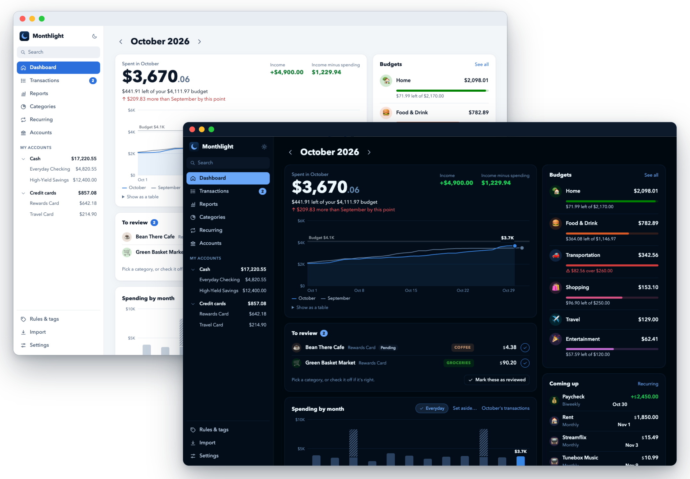
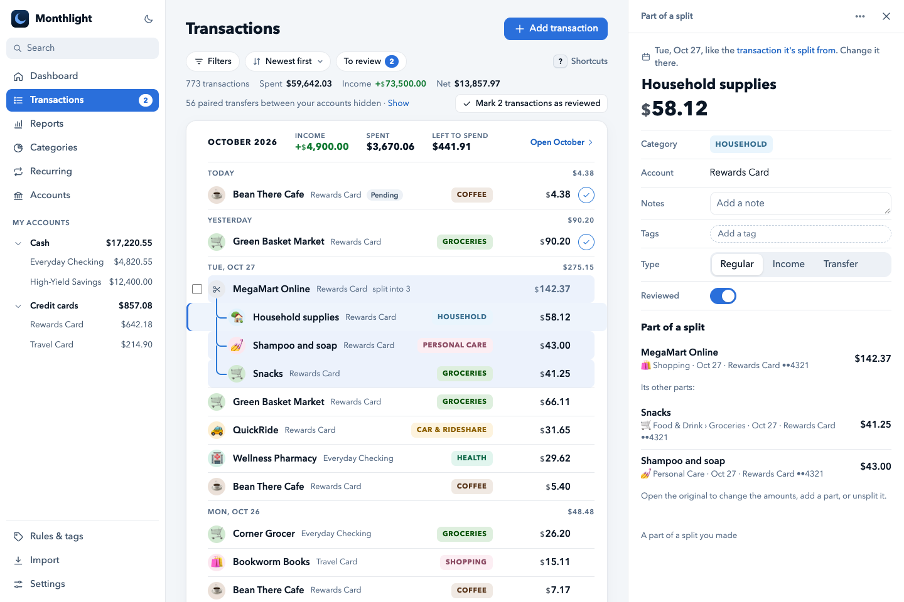
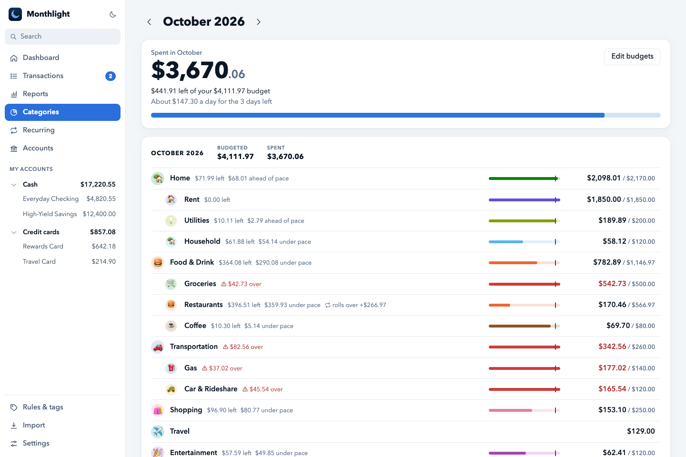
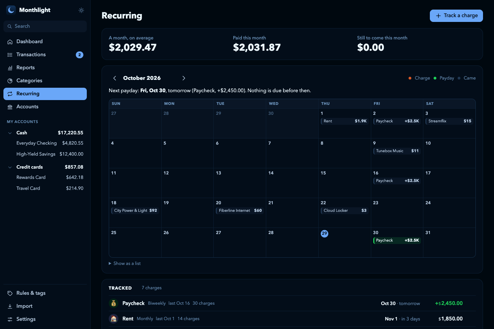
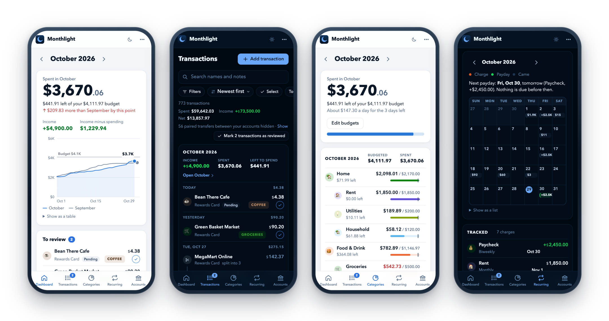

<p align="center">
  
</p>

<h1 align="center">Monthlight</h1>

<p align="center">
  <strong>Your money, month by month, on your own computer.</strong><br>
  A self-hosted personal finance app in the spirit of <a href="https://copilot.money">Copilot Money</a>.
</p>

<p align="center">
  <a href="https://github.com/Fau818/monthlight-money/actions/workflows/tests.yml"></a>
  
  
  <a href="LICENSE"></a>
</p>

<p align="center">
  <a href="#getting-started">Get started</a> · <a href="docs/guide.md">User guide</a> · <a href="ROADMAP.md">Roadmap</a>
</p>



Monthlight syncs your bank accounts through Plaid, puts every transaction in its place, and shows where each month's
money went. It runs in Docker on your own computer and keeps your data there, in one file, backed up every day. It isn't
affiliated with [Copilot Money](https://copilot.money), and it can import your history from it.

## See where the money goes

- **Reports:** spending or income over any span, by month, quarter or year, and by category, merchant, account or tag,
  each compared with the span before and the same span a year earlier. Leave things out of one report without changing
  a transaction, click a bar for its transactions, and save a report or pin it to the dashboard.
- **Everyday spending:** set aside the big, rare costs, like a semester's tuition, to see what you spend from day to
  day. They still count, shown apart on each month's bar.
- **A month in review:** how each month went against your budgets, the categories and merchants that changed most, the
  biggest expenses, and how your net worth moved.

## Keep every transaction right

- **Transactions:** one line each, month by month, with the one you pick open beside the list. A filter menu, chips for
  what's filtered, several changed at once, and keyboard shortcuts.
- **Clean and connected:** names without the codes banks add, rules that learn, splits, tags, linked transactions,
  paybacks from friends that count with their purchase, and moves between your own accounts that count nowhere.



## Plan the month

- **Categories and budgets:** each category against its budget, with the month's pace and the bills still to come.
  Budgets can differ by month, and what's left or over can roll into the next.
- **Recurring:** a calendar of bills and paydays, and what's due before the next payday.
- **Accounts:** balances as your bank shows them, a page for each account with its balance over time and a card's
  limit used, and your net worth.

<table>
  <tr>
    <td width="50%">

    </td>
    <td width="50%">

    </td>
  </tr>
</table>

## On your phone, too

The same app on your phone, laid out for its screen, through a private connection to your computer
([remote access](docs/remote-access.md)).



## Yours, and private

- **On your computer:** no cloud service and no account to make. The app listens only on this computer.
- **Safe:** a copy of your data every day, the last 30 kept, and everything as CSV whenever you want it.
- **Comfortable:** light or dark as your system has it, or as you pick, on the computer and on your phone.

## Getting started

You need Docker (OrbStack or Docker Desktop on a Mac, Docker Engine on Linux) and your own [Plaid](https://plaid.com) account for its API keys. Plaid's free Trial plan is enough.

1. **Get the code.** Keep it out of folders that iCloud Drive, Dropbox or OneDrive sync: syncing a database while the app uses it can damage it.

   ```sh
   git clone https://github.com/Fau818/monthlight-money.git
   cd monthlight-money
   mkdir -p data import backups
   cp .env.example .env
   ```

   On Linux, the app runs as user ID 1000. If yours differs (`id -u`), also run `sudo chown -R 1000:1000 data import backups`.

2. **Fill in `.env`:** your Plaid keys, your time zone, and `PLAID_ENV=production` for your real banks (see [Settings](#settings)).

3. **Start it** with `docker compose up -d`, and open http://localhost:8080.

4. **Coming from [Copilot Money](https://copilot.money)?** Import your history on **Settings → Import from Copilot** before you connect your banks.

5. **Connect your banks** on **Accounts → Connect a bank**. Plaid's Trial plan allows 10 bank connections in total, and disconnecting one doesn't give its slot back, so connect each bank once.

**Trying it first?** Leave `PLAID_ENV=sandbox` in step 2 and connect Plaid's test banks (log in as `user_good`, password `pass_good`). Before you switch to your real banks, stop the app and delete `data/money.db*`.

## Settings

They live in `.env`. After changing one, run `docker compose up -d`.

| Name | What it does |
|---|---|
| `PLAID_CLIENT_ID`, `PLAID_SANDBOX_SECRET`, `PLAID_PRODUCTION_SECRET` | Your Plaid keys, from https://dashboard.plaid.com/developers/keys. |
| `PLAID_ENV` | `sandbox` for Plaid's test banks, `production` for your real ones. |
| `TZ` | Your time zone, like `America/New_York`, for today's date and the day each purchase falls on. Empty means UTC. |
| `SYNC_INTERVAL_HOURS` | Hours between automatic syncs, 6 unless you set it; 0 turns them off. |
| `REMOTE_HOSTS` | Optional: the names your other devices reach the app by (see [remote access](docs/remote-access.md)). |

## Backups

Every day the app saves a copy of the database in `backups/` and keeps the last 30. **Settings** shows the latest one. To go back to a copy (anything changed after that day is lost):

```sh
docker compose stop
mkdir -p data/replaced && mv data/money.db* data/replaced/
cp backups/money-2026-10-14.db data/money.db
docker compose up -d
```

## Privacy and security

The app has no login and listens only on this computer (127.0.0.1), so never open it to your network or the internet. `.env` holds your Plaid keys, and `data/` and `backups/` hold your financial data and bank access tokens: keep them private and out of git. `.gitignore` already excludes them.

## More

- [User guide](docs/guide.md): reports, budgets, reviewing, splits, paybacks, moves between accounts, links, tags and more
- [Use it from your phone](docs/remote-access.md), through Tailscale or Surge Ponte
- [Roadmap](ROADMAP.md)

## Development

With [uv](https://docs.astral.sh/uv/):

```sh
uv run pytest                                                       # the tests, with a fake Plaid client
uv run --env-file .env.example python scripts/demo_data.py demo     # a database of made-up data, then:
DATA_DIR=demo BACKUP_DIR=demo/backups IMPORT_DIR=demo/import uv run --env-file .env.example uvicorn app.main:app --port 8081
```

## License

MIT; see [LICENSE](LICENSE).
