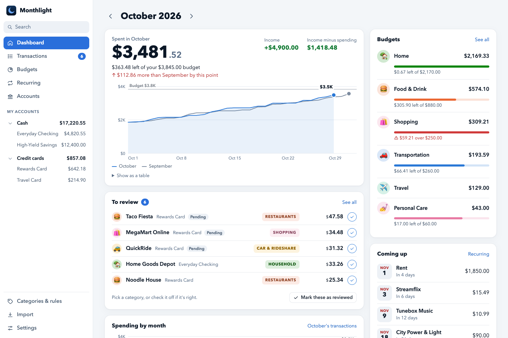
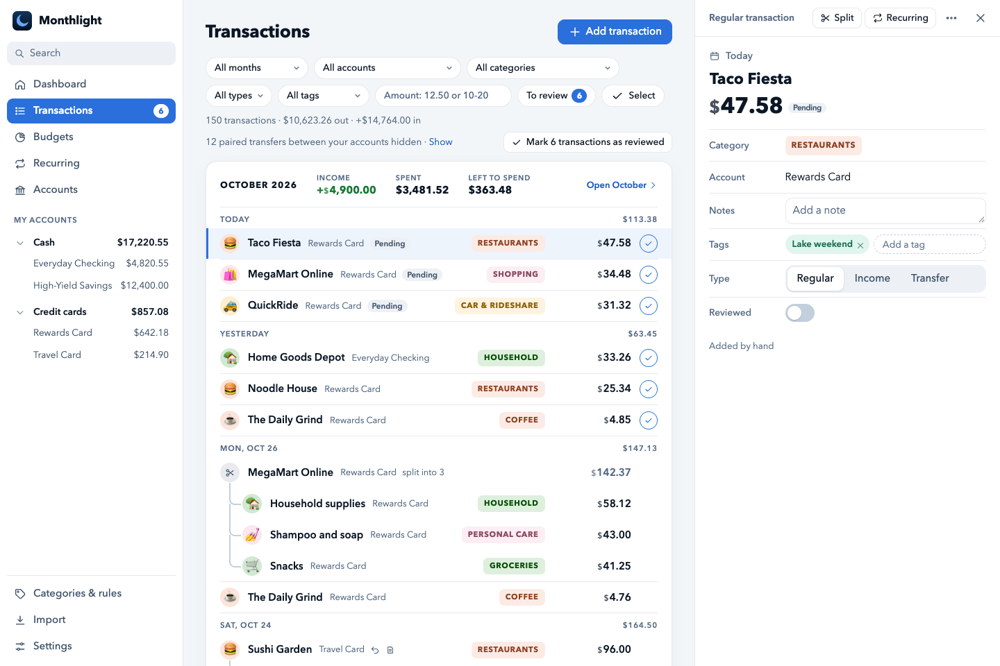

# Monthlight

A self-hosted personal finance app. It syncs your bank accounts through Plaid, sorts your spending into categories and
budgets, and shows where each month's money went. It runs on your own computer, in Docker, and keeps your data there.
It's inspired by [Copilot Money](https://copilot.money) (and not affiliated with it), and it can import your history from it.

<picture>
  <source media="(prefers-color-scheme: dark)" srcset="docs/images/dashboard-v0.2-dark.png">
  
</picture>

## Features

- **Dashboard:** this month's spending day by day next to last month's, budgets, transactions to review, upcoming bills and net worth.
- **Transactions:** one line each, month by month, with the one you pick open beside the list. Search and filters, categories picked right in the list, rules, splits, tags, and paybacks from friends.
- **Budgets and recurring charges**, with what's left this month.
- **Accounts:** balances, card limits and net worth over time.
- **Your data stays with you:** one SQLite file, a backup every day, and a CSV export.

<picture>
  <source media="(prefers-color-scheme: dark)" srcset="docs/images/transactions-v0.2-dark.png">
  
</picture>

## Getting started

You need Docker (OrbStack or Docker Desktop on a Mac, Docker Engine on Linux) and your own [Plaid](https://plaid.com) account for its API keys. Plaid's free Trial plan is enough.

1. **Get the code.** Keep it out of folders that iCloud Drive, Dropbox or OneDrive sync: syncing a database while the app uses it can damage it.

   ```sh
   git clone https://github.com/Fau818/monthlight-money.git
   cd monthlight-money
   mkdir -p data import backups
   cp .env.example .env
   ```

   On Linux, the app runs as user ID 1000. If yours differs (`id -u`), also run `sudo chown -R 1000:1000 data import backups`.

2. **Fill in `.env`:** your Plaid keys, your time zone, and `PLAID_ENV=production` for your real banks (see [Settings](#settings)).

3. **Start it** with `docker compose up -d`, and open http://localhost:8080.

4. **Coming from [Copilot Money](https://copilot.money)?** Import your history on **Settings → Import from Copilot** before you connect your banks.

5. **Connect your banks** on **Accounts → Connect a bank**. Plaid's Trial plan allows 10 bank connections in total, and disconnecting one doesn't give its slot back, so connect each bank once.

**Trying it first?** Leave `PLAID_ENV=sandbox` in step 2 and connect Plaid's test banks (log in as `user_good`, password `pass_good`). Before you switch to your real banks, stop the app and delete `data/money.db*`.

## Settings

They live in `.env`. After changing one, run `docker compose up -d`.

| Name | What it does |
|---|---|
| `PLAID_CLIENT_ID`, `PLAID_SANDBOX_SECRET`, `PLAID_PRODUCTION_SECRET` | Your Plaid keys, from https://dashboard.plaid.com/developers/keys. |
| `PLAID_ENV` | `sandbox` for Plaid's test banks, `production` for your real ones. |
| `TZ` | Your time zone, like `America/New_York`, for today's date and the day each purchase falls on. Empty means UTC. |
| `SYNC_INTERVAL_HOURS` | Hours between automatic syncs, 6 unless you set it; 0 turns them off. |
| `REMOTE_HOSTS` | Optional: the names your other devices reach the app by (see [remote access](docs/remote-access.md)). |

## Backups

Every day the app saves a copy of the database in `backups/` and keeps the last 30. **Settings** shows the latest one. To go back to a copy (anything changed after that day is lost):

```sh
docker compose stop
mkdir -p data/replaced && mv data/money.db* data/replaced/
cp backups/money-2026-10-14.db data/money.db
docker compose up -d
```

## Privacy and security

The app has no login and listens only on this computer (127.0.0.1), so never open it to your network or the internet. `.env` holds your Plaid keys, and `data/` and `backups/` hold your financial data and bank access tokens: keep them private and out of git. `.gitignore` already excludes them.

## More

- [User guide](docs/guide.md): reviewing, splits, paybacks, moves between accounts, links, tags and more
- [Use it from your phone](docs/remote-access.md), through Tailscale or Surge Ponte
- [Roadmap](ROADMAP.md)

## Development

With [uv](https://docs.astral.sh/uv/):

```sh
uv run pytest                                                       # the tests, with a fake Plaid client
uv run --env-file .env.example python scripts/demo_data.py demo     # a database of made-up data, then:
DATA_DIR=demo BACKUP_DIR=demo/backups IMPORT_DIR=demo/import uv run --env-file .env.example uvicorn app.main:app --port 8081
```

## License

MIT; see [LICENSE](LICENSE).
